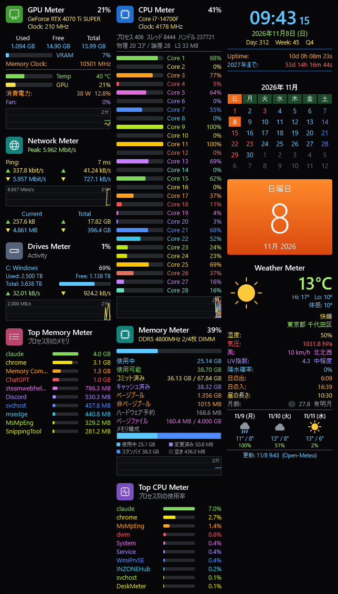
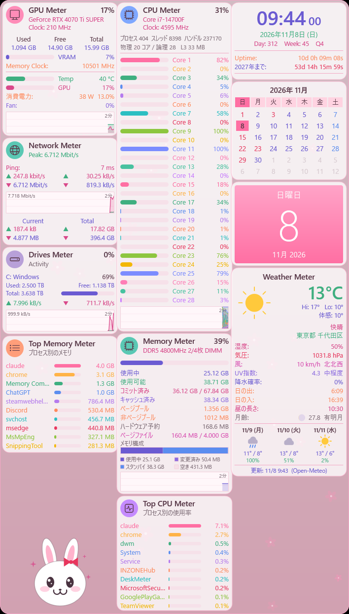
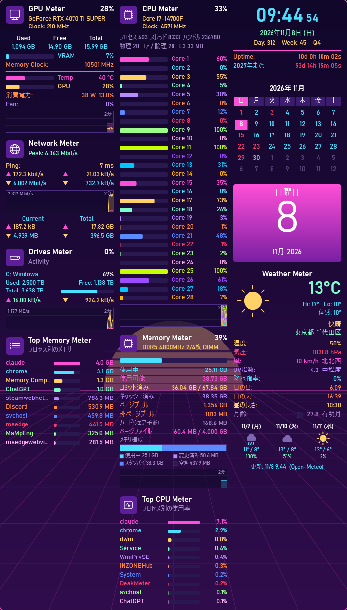
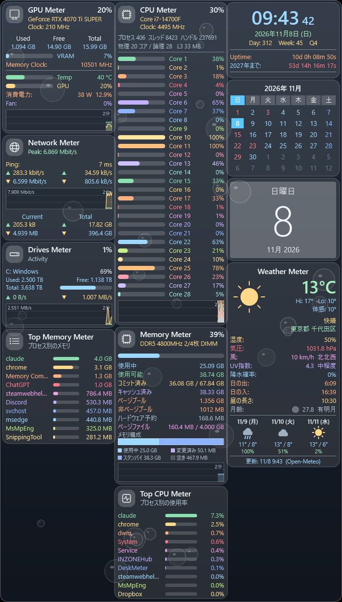
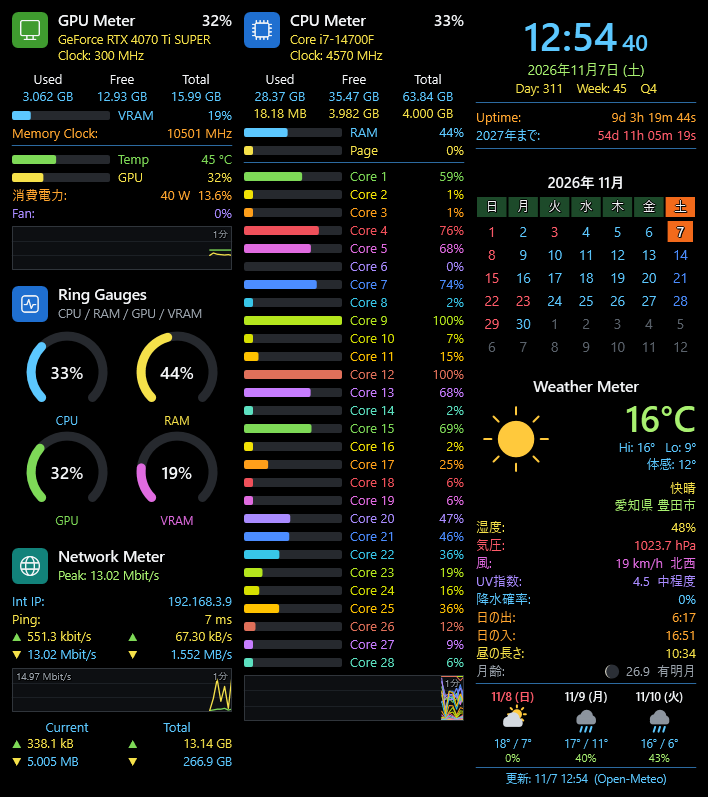
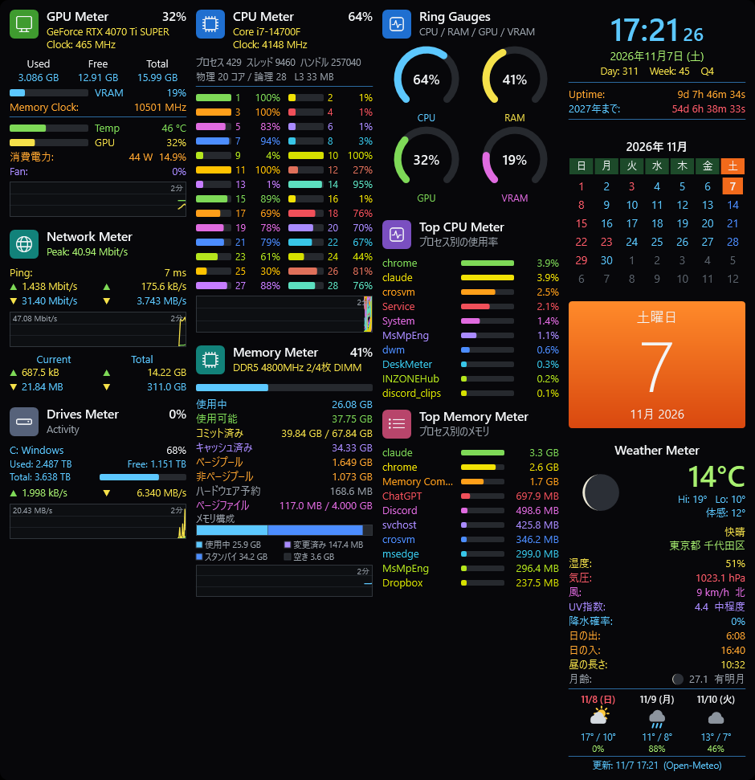
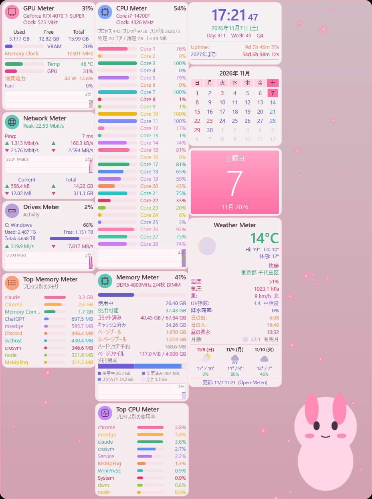
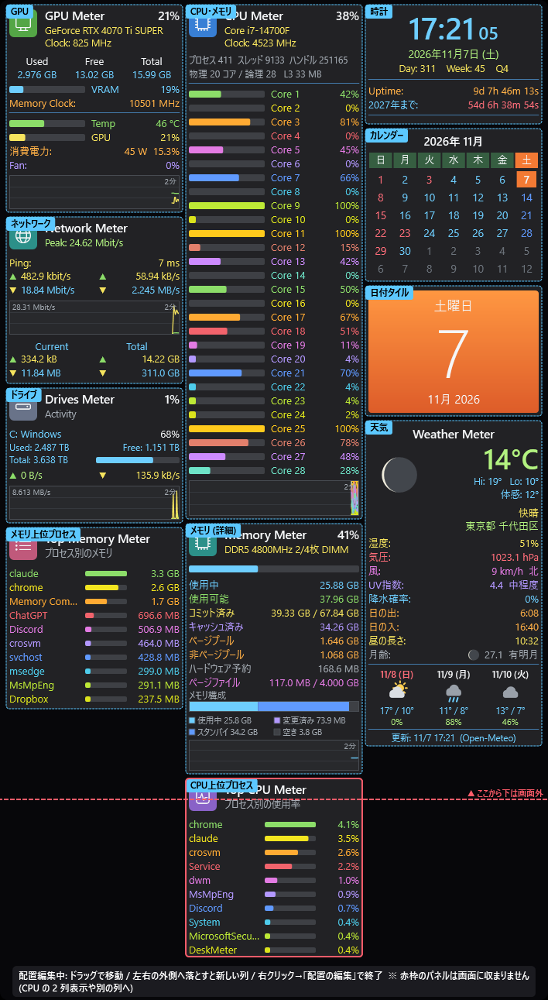
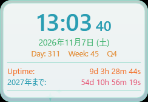
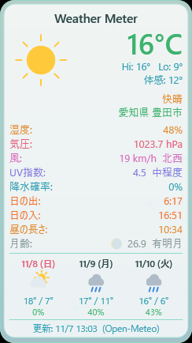

# DeskMeter

[](https://github.com/KARASAWA808/DeskMeter/actions/workflows/build.yml)

Rainmeter 風の、デスクトップ常駐リソースモニターです。Windows 10 / 11 で、インストール不要・追加ランタイム不要（.NET Framework 4.8 同梱のものを使用）の単一 exe として動きます。



## 表示できるもの

| パネル | 内容 |
| --- | --- |
| CPU Meter | 全体と論理プロセッサごとの使用率、実クロック、プロセス/スレッド/ハンドル数、物理コア数、L3。HWiNFO64 連携で温度・電力・ファン |
| Memory Meter | 使用中（圧縮）、使用可能、コミット、キャッシュ、ページ/非ページプール、ハードウェア予約、ページファイル、メモリ構成（使用中/変更済み/スタンバイ/空き）、種類・速度・スロット数 |
| GPU Meter | 使用率、温度、VRAM、クロック、消費電力、ファン（NVIDIA、`nvidia-smi` 経由）。NVIDIA 以外の GPU は使用率と VRAM のみ（Windows の GPU カウンター） |
| Network Meter | 上り/下り速度、ピーク、Ping、起動後と累計の通信量、内部 IP |
| Drives Meter | 容量と使用率、読み書き速度 |
| Top CPU / Top Memory Meter | プロセス別の上位 10 件 |
| Ring Gauges | CPU / RAM / GPU / VRAM の円形ゲージ |
| 時計・カレンダー・日付タイル | 稼働時間、新年までのカウントダウン、日本の祝日 |
| Weather Meter | 現在の天気と 3 日予報（Open-Meteo、API キー不要）、月齢 |

## 見た目のカスタマイズ

- **スキン** 12 種（Classic / Cyberpunk / Retro / Light / Kawaii Pink / Kawaii Mint / Synthwave / Matrix / Nord / Dracula / Frost / Notebook）。`skins\*.json` で自作もできます（`help\custom-skin.html`）。
- **配置の編集**: 右クリック →「配置の編集」でパネルをドラッグして並べ替え。列は最大 6 つ。
- **パネルの切り離し**: パネルごとに独立ウィンドウにして、別モニターにも置けます。
- **配置プリセット** と **テーマ**（スキン・配置・画像などの一式を保存・切替）。
- **透明モード**: 背景の不透明度 0% ＋ 文字の縁取りで、壁紙の上に文字だけを浮かせられます。
- **画像**: 背景画像、マスコット画像（立ち絵を横に並べる配置も可）。

| Kawaii Pink | Synthwave | Frost |
| --- | --- | --- |
|  |  |  |

| 透明モード + リングゲージ | 配置プリセット「ダッシュボード」 | マスコット画像（右に並べる） |
| --- | --- | --- |
|  |  |  |

| 配置の編集 | 切り離した時計と天気 |
| --- | --- |
|  |   |

## 使い方

1. [Releases](../../releases) から zip をダウンロードして展開し、`DeskMeter.exe` を実行します。
   初回は SmartScreen の警告が出ることがあります。「詳細情報」→「実行」で起動できます。
2. 右クリックでメニューが開きます。左ドラッグで移動します。タスクトレイのアイコンからも同じメニューを開けます。
3. 設定は exe と同じフォルダーの `settings.json` に保存されます（メニューの「設定ファイルを開く」で編集。保存すると自動で反映されます）。

主なメニュー: スキン / 表示モード（デスクトップに固定・常に最前面・通常）/ モニターへ移動 / サイズ / 背景の不透明度 / 更新間隔 / グラフの時間幅 / 表示する項目 / 配置の編集 / パネルを切り離す / 配置プリセット / テーマ / 画像 / ホットキー / 天気の場所を設定 / Windows 起動時に開始 / 設定を初期値に戻す / フォルダーとログを開く / ヘルプ

### 更新するとき

新しい zip の `DeskMeter.exe` と `help\`、`skins\` のファイルを上書きするだけです。`settings.json`、自作のスキン（`skins\` に足したもの）、`themes\` はそのまま使えます。

### アンインストール

1. メニューの「Windows 起動時に開始」のチェックを外します（レジストリ `HKEY_CURRENT_USER\Software\Microsoft\Windows\CurrentVersion\Run` の `DeskMeter` が消えます）。
2. 「終了」で閉じて、フォルダーごと削除します。

書き込む場所はこのフォルダーと上のレジストリ値だけです。フォルダーには `settings.json`、`deskmeter.log`、壊れた設定の退避 `settings.broken-*.json`、「設定を初期値に戻す」の前のバックアップ `settings.backup-*.json`、保存したテーマ `themes\` ができます。

### ログと不具合の報告

エラーは exe と同じフォルダーの `deskmeter.log` に書かれます（メニューの「フォルダーとログを開く」から開けます）（512 KB を超えると次の書き込み時に消して作り直します）。設定・スキン・画像の読み込みに問題があったときはタスクトレイの通知でも知らせます。

不具合は [Issues](../../issues) へ。DeskMeter の版（メニューの「ヘルプ」の一番下に出ます。`deskmeter.log` の先頭行にも版と Windows の版が入ります）、`deskmeter.log`、できれば `settings.json`（`Latitude`/`Longitude`/`LocationName` は消して構いません）を添えてもらえると助かります。

版ごとの変更点は [CHANGELOG.md](CHANGELOG.md) にあります。新しい版は「ヘルプ」→「DeskMeter vX.Y.Z - 新しい版を確認する」で Releases ページを開いて確かめられます（自動では確認しません）。

## 動作環境

- Windows 10 / 11（64 ビット）。.NET Framework 4.8 が必要です。Windows 10 バージョン 1903 以降と Windows 11 には最初から入っています。それより古い Windows 10 では、Microsoft の .NET Framework 4.8 インストーラーを先に入れてください。
- GPU パネルの温度・クロック・消費電力・ファンは NVIDIA GPU（ドライバー付属の `nvidia-smi.exe`）が必要です。AMD / Intel の GPU では、タスクマネージャーと同じ Windows の GPU カウンター（Windows 10 1709 以降）から使用率と VRAM 使用量だけを表示します。
- CPU 温度などは Windows 標準では取れないため、HWiNFO64 の「Shared Memory Support」を有効にしたときだけ表示されます（`help\hwinfo.html`）。
- **Smart App Control** が有効な PC では、署名のない exe は起動できません。その場合は下記の方法でその PC 上でビルドしてください。

## 外部への通信

- 天気: Open-Meteo（`api.open-meteo.com`）に設定した緯度・経度を 15 分おきに送ります。初期値は東京駅付近です。メニューの「天気の場所を設定」で「天気を取得しない」にすると通信しません。
- 場所の検索: 「天気の場所を設定」で地名を検索したときだけ、入力した地名を Open-Meteo のジオコーディング（`geocoding-api.open-meteo.com`）に送ります。
- Ping: `settings.json` の `PingHost`（既定 `1.1.1.1`）へ 5 秒おき（更新間隔を 5 秒より長くしたときはその間隔）。空文字で無効。
- 天気パネルをダブルクリックすると、設定した緯度・経度を付けた windy.com を既定のブラウザーで開きます（アプリ自身は通信しません）。
- それ以外の通信はありません。

## ビルド方法（SDK 不要）

Windows に同梱されている C# コンパイラでビルドします。Visual Studio や .NET SDK は不要です。

```bash
powershell -ExecutionPolicy Bypass -File build.ps1
```

`DeskMeter.exe` がフォルダー直下にできます。アイコンを変えたいときは `make-icon.ps1` で `app.ico` を作り直してからビルドします。

## 常駐時の負荷の目安

既定（1 秒更新、100%、Classic）で 1 コアの 2〜4%（28 コア機で全体の 0.1% 程度）、メモリ約 100 MB（ソフトウェア描画、GPU デバイスを作りません）。再描画は計測が終わるたびに 1 回だけで、ウィジェットを隠している間・ロック中・画面が消えている間・フルスクリーンのアプリ（ゲームや全画面の動画）が DeskMeter のあるモニターを覆っている間（最前面モード以外。別のモニターに見えていれば止まりません）は、計測も `nvidia-smi` も止まります。

タスクマネージャーのメモリ欄は 170 MB 前後に見えますが、そのうち約 150 MB は WPF が初期化する GPU ドライバーの DLL（NVIDIA では nvgpucomp64.dll など）を他のプロセスと共有しているぶんで、このアプリ固有の消費（プライベートバイト）は 90 MB 前後です。

負荷はウィンドウの面積と描画回数に比例します。半透明ウィンドウの合成が主な内訳なので、サイズ 150% やカード付きのスキン（Nord、Frost など）、0.25〜0.5 秒更新では数倍になります（0.25 秒更新・150%・Nord で 1 コアの 10〜15% 程度）。計測が 0.5 秒より速いときは、グラフの点は計測ごとに積みつつ描画だけ 0.5 秒ごとに間引きます。バッテリー駆動中は `nvidia-smi` への問い合わせを 10 秒ごとにします。

負荷の内訳を調べたいときは、環境変数 `DESKMETER_PROFILE=1` を付けて起動すると、描画と計測にかかった時間が 30 秒ごとに `deskmeter.log` に書かれます。`DESKMETER_NO_SMI=1` を付けると `nvidia-smi` を使わず、NVIDIA 以外の環境と同じ表示になります（表示確認用）。

## settings.json の項目

メニューで変えられるものがほとんどですが、`ShowIp` / `ShowForecast` / `ShowHolidays` と `Hotkey` の自由な組み合わせはファイルを直接編集します。範囲外の値は既定値に戻るか、範囲内に丸められます。読めない項目があるときは、その項目だけ既定値にして通知します。

| 項目 | 既定値 | 意味 |
| --- | --- | --- |
| `Skin` | `"Classic"` | 内蔵スキン名、または `skins\*.json` のファイル名（拡張子なし） |
| `Scale` | `1.0` | 表示倍率。0.5〜3.0 |
| `BackgroundOpacity` | `0.82` | 背景の不透明度。0〜1 |
| `TextShadow` | `"auto"` | 文字の影・縁取り。`"auto"`（不透明度 50% 未満のとき）/ `"on"` / `"off"` |
| `Mode` | `"desktop"` | `"desktop"`（デスクトップに固定）/ `"topmost"`（常に最前面）/ `"normal"` |
| `Locked` / `ClickThrough` | `false` | 位置の固定 / クリックの透過 |
| `IntervalMs` | `1000` | 更新間隔（ミリ秒）。250〜10000 |
| `HistorySeconds` | `120` | グラフの時間幅（秒）。30〜1800 |
| `Hotkey` | `""` | 表示/非表示のホットキー。`"Ctrl+Alt+D"` のように `Ctrl` / `Alt` / `Shift` / `Win` とキー名（`A`〜`Z`、`0`〜`9`、`F1`〜`F12`、`Space` など）を `+` でつなぐ。空で無効 |
| `Layout` | 標準の 3 列 | 列ごとのパネル ID の配列。ID は `gpu` `cpu` `memory` `network` `drives` `topcpu` `topmem` `rings` `clock` `calendar` `datetile` `weather`。最大 6 列 |
| `CompactCores` | `false` | コアごとの使用率を 2 列に詰める |
| `Floating` / `FloatPositions` | `[]` | 切り離したパネルの ID と、その位置（モニター名と位置・大きさ、作業領域の左上からのピクセル） |
| `Monitor` / `MonitorRect` / `AnchorH` / `AnchorV` / `MonX` / `MonY` | メイン / `"right"` / `"top"` / `8` / `8` | 本体の位置。どのモニターの、どの端（`left`/`right`、`top`/`bottom`）から何ピクセルか。`MonitorRect` はモニターの位置と大きさで、番号が振り直されても同じモニターを探すのに使います |
| `BackgroundImage` / `BackgroundImageOpacity` | `""` / `0.35` | 背景画像（絶対パス、または exe のフォルダーからの相対パス）とその濃さ 0〜1 |
| `MascotImage` / `MascotPlacement` / `MascotSize` | `""` / `"free"` / `220` | マスコット画像、置き方（`free` / `right` / `left`）、最大の高さ 60〜1200 px |
| `ShowIp` | `true` | ネットワークパネルに内部 IP を出す。配信や画面共有で隠したいときは `false` |
| `PingHost` | `"1.1.1.1"` | Ping の宛先。空で無効 |
| `WeatherEnabled` | `true` | `false` で天気を取得しない |
| `Latitude` / `Longitude` / `LocationName` | `35.68` / `139.77` / `"東京都 千代田区"` | 天気の場所と表示名（`help\weather-location.html`） |
| `ShowForecast` | `true` | 天気パネルに 3 日予報を出す |
| `ShowHolidays` | `true` | カレンダーに日本の祝日を出す |
| `MemoryPanelAdded` / `Left` / `Top` | | 古い設定からの移行用。触らなくて構いません |

## コマンドライン

| 引数 | 動き |
| --- | --- |
| `--snapshot out.png [--delay 秒] [--edit]` | 描画内容を PNG に保存して終了します（既定 8 秒後。`--edit` で配置編集中の見た目）。README のプレビューはこれで撮っています（`tools\make-previews.ps1` でスキンのプレビューを撮り直せます） |
| `--reload` | 起動中の DeskMeter に設定ファイルの再読み込みを頼んで終了します |
| `--toggle-edit` | 起動中の DeskMeter の配置編集モードを切り替えて終了します |

2 つ目の `DeskMeter.exe` を普通に起動すると、先に動いているものを表示して自分は終了します。

## English

DeskMeter is a Rainmeter-style always-on-desktop resource monitor for Windows 10 / 11: a single `DeskMeter.exe` with no installer and no extra runtime (it uses the .NET Framework 4.8 that ships with Windows). It shows CPU (per core, per process), memory, GPU (NVIDIA via `nvidia-smi`; other GPUs via Windows counters), network, drives, clock, calendar with Japanese holidays, and weather (Open-Meteo). It can sit behind other windows or stay on top, comes with 12 skins plus JSON custom skins, supports detached panels on other monitors, and pauses sampling while hidden, locked, the display is off, or a fullscreen app covers it. The UI and documentation are in Japanese. Download the zip from [Releases](../../releases), extract it, and run `DeskMeter.exe`; settings live in `settings.json` next to the exe. Build from source with `build.ps1` (uses the C# compiler bundled with Windows).

## ライセンス

[MIT License](LICENSE)
